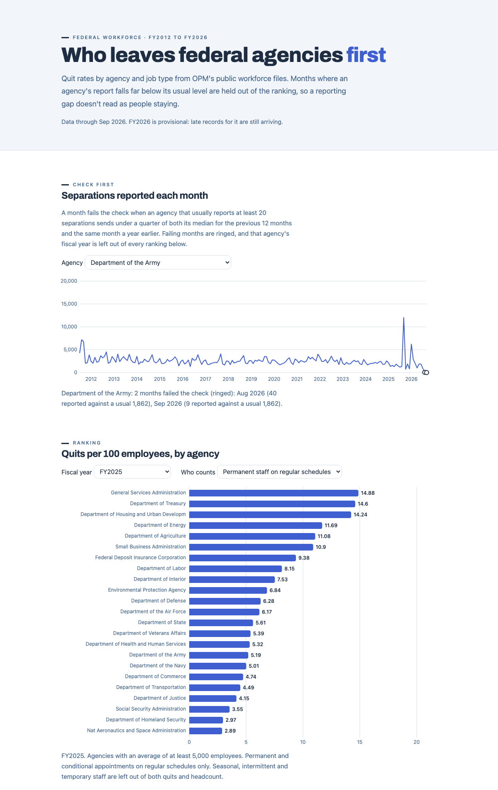

# Who leaves federal agencies first

Which federal agencies and job types lose people fastest, and how much of that is people choosing to quit? I answered it from OPM's public workforce files, FY2012 to FY2026. Two checks run before any ranking. One catches months when an agency's report is incomplete, because a missing report looks like nobody left. The other separates permanent staff from seasonal and temporary jobs, because those jobs end by design and crowd the top of a raw quit ranking.



## Summary

I pulled every OPM separations file from Jul 2011 to Sep 2026 (183 monthly files, about 3.8 million rows) and a September headcount snapshot for each year, then built yearly quit rates per 100 employees by agency and by occupational group. A coverage check compares each agency's monthly report with its own previous year. In the Sep 2026 file the Army reports 9 separations against a usual month of about 1,860, while still employing 180,217 people. Seventeen agency-months since Jul 2011 fail the check, and the years they belong to are listed instead of ranked. On the raw numbers, Commerce, Interior and Agriculture lead the quit ranking nearly every year. Among permanent staff on regular schedules, the agencies that lead every year are Veterans Affairs and the Army.

## Problem

A workforce planner or HR leader looking at federal turnover wants to know where people are leaving and whether they are choosing to. Raw separation counts mislead in four ways.

- A month with missing submissions looks like perfect retention. An agency that sends almost nothing ranks as the most stable employer in the government.
- People who leave in one month show up in later files. About one in five rows in the Sep 2026 file is someone who left earlier.
- Seasonal, intermittent and temporary jobs end on a schedule. In FY2024 they were about 8% of headcount in the agencies I could rank and about 28% of quits.
- About 110,000 separations in FY2025 carry OPM's flag for the Deferred Resignation Program. Most are coded as resignations, so they read like an ordinary wave of quits.

A ranking that ignores these points a planner at the wrong agencies.

## Inputs

| Source | What | How I got it |
|---|---|---|
| OPM Federal Workforce Data, separations | One row per person who left a covered agency, 69 fields (agency, occupation, reason, tenure, work schedule, effective month and more). 183 monthly files, Jul 2011 to Sep 2026, plus 12 earlier files used only as the coverage check's first-year baseline | Open API, Parquet files, pulled by `fas/pull.py` |
| OPM Federal Workforce Data, employment | One row per employee on the rolls at a snapshot. I use the 16 September snapshots, 2011 to 2026, about 2 million rows each | Same API |
| BLS Job Openings and Labor Turnover Survey | Monthly quits rate for Federal, State and local, Total nonfarm and three private industries, 2011 to 2026 | BLS public API |

OPM's data covers most executive branch civilian employees. By design it leaves out the Postal Service, the intelligence agencies, Census Bureau temporary workers, the State Department's foreign service and about 15 other groups.

## Discovery

**Missing data looks like retention.** The Army reported 2,430 separations in the Sep 2024 file and 9 in the Sep 2026 file. The Air Force went from 2,220 to 26. Both still had over 150,000 people on the September 2026 rolls. OPM's site says a change in Department of War data processing is affecting some components' September 2026 data. My check also flags August 2026 for the Army, the Air Force and the Defense Department's own offices.

**Not every low month is a gap.** The Agency for International Development reports very few separations in FY2026 because very few people are left (4,800 employees in Sep 2024, 1,101 in Sep 2025, 230 in Sep 2026). The check skips agencies whose headcount fell by more than half in the year. Seasonal agencies have low months every winter, so a month only fails if it is also far below the same month a year earlier.

**The raw leaders are seasonal employers.** Commerce, Interior and Agriculture top the raw quit ranking. In FY2024, 768 of Commerce's 2,384 quits came from permanent staff on regular schedules. Its quit rate falls from 4.89 to 1.85 per 100 when seasonal, intermittent and temporary jobs are left out of both the quits and the headcount.

**2025 is two stories.** The quit rate across the agencies I could rank went from 3.57 per 100 in FY2024 to 7.04 in FY2025. Leaving out quits OPM flags as part of the Deferred Resignation Program, FY2025 is 4.2.

**Dead end:** I tried to match late records against earlier files to rule out double counting. The files have no person ID, and identical rows also occur between different people inside one file, so an exact match proves nothing. I count every row and say so (DECISIONS.md, entry 4).

## Execution

```
OPM API ─┐                                            ┌─ data/clean/*.csv ── dashboard
         ├─ fas/pull.py ── data/raw ── sql/build.sql ─┤
BLS API ─┘  (resumable)    (gitignored)    (DuckDB)   └─ fas/contract.py (CI)
```

1. **Pull.** `fas/pull.py` keeps a manifest of every file with its version and checksum. A file is written as `.part` and renamed only when complete. A stopped run resumes where it stopped, a second run downloads nothing, and a new OPM version of a month is pulled while the old one is kept. When I widened the window by a year, the next run downloaded the 12 new files and skipped the 199 it already had.
2. **Coverage check.** For each agency and file month, compare separations with the median of the previous 12 file months and with the same month a year earlier. Under a quarter of both, for an agency that normally reports 20 or more, is a gap. Any gap month marks the agency's fiscal year incomplete. `scripts/sensitivity.py` shows how the count moves with the thresholds.
3. **Rates.** Quits and every other reason per 100 employees, using the average of the September headcount before and at the end of the fiscal year. Each rate also comes in a permanent-staff version (tenure groups 1 and 2, regular schedules), and exit-program quits are counted apart.
4. **Contract.** `DATA_CONTRACT.md` and `contract/tables.v1.json` define every column of every output table. CI fails on a missing column, a wrong type, reasons that don't add up, or a rate without its trust flags.

Options I turned down, and what each choice cost, are in [DECISIONS.md](DECISIONS.md): R instead of Python, monthly headcount (about 12.6 GB), counting by file month, treating gaps as zero, ranking all staff together, and folding exit programs into quits.

## Results

**Among permanent staff, the same agencies lead every year.** Among agencies with 5,000 or more employees, Veterans Affairs and the Army are in the top five for permanent-staff quit rate in all 13 complete years from FY2012 to FY2024. The Defense Department's own offices (OPM lists the Army, Navy and Air Force separately) are there in 12 and Homeland Security in 11. On the raw rate, Commerce is in the top five in all 13 years, Interior in 12 and Agriculture in 11. None of the three reaches the top five for permanent staff in any of those years.

**By job type, the spread is wide.** In FY2024, permanent staff in general services and support work quit at 7.44 per 100, and in food preparation and serving at 5.84. At the low end, equipment, facilities and services was 1.56 and information technology, the largest group at about 98,000 people, was 1.62.

**Federal quitting is low next to the rest of the economy.** In FY2024, OPM's covered agencies show 3.57 quits per 100 (2.80 for permanent staff) and BLS shows 6.4 for federal jobs, against 25.8 for all jobs. OPM's and BLS's federal rates rise and fall together (correlation 0.76, FY2012 to FY2024). They measure different groups, so I read the space between them as a range.

What I'd tell a workforce planner:

1. Check coverage before reading any agency's turnover. A month at a quarter of its usual level is a question for the data team before it is a retention result.
2. Rank permanent staff separately. Seasonal and temporary turnover is a staffing-calendar question, and it hides where permanent employees leave.
3. Read 2025 and 2026 with exit programs split out. Otherwise program exits look like a wave of people choosing to quit.

**Limits.** FY2026 is provisional: late records and more exit-program actions are still being processed. Small agencies are left out of rankings because a few people move their rate a lot. The permanent-staff definition uses OPM's tenure and work-schedule codes and leaves out senior executives, who sit outside the tenure groups. OPM's field documentation for the exit-program flag wasn't available to me, so I read the flag from OPM's own description of the program (DECISIONS.md, entry 6).

**Next steps.** Rerun the pull each month and watch the flagged months fill in. Split permanent-staff quits by length of service to see whether people leave in their first years.

## How to run

```bash
python -m venv .venv && source .venv/bin/activate
pip install -r requirements.txt
python -m fas.pull          # about 1.2 GB into data/raw, safe to stop and rerun
python -m fas.build         # data/raw -> data/clean and dashboard/data
python -m fas.contract      # check the tables against the contract
python -m pytest -q         # tests use small synthetic files, no network
python -m http.server 8000 --directory dashboard
```

`python scripts/findings.py` prints every number quoted in this README into `docs/findings.json`. `python scripts/sensitivity.py` reruns the threshold table in `docs/sensitivity.txt`. `python scripts/late_record_check.py 2026 09` reruns the late-record check.

## Repo map

| Path | What |
|---|---|
| `fas/pull.py` | Resumable, versioned data pull |
| `sql/build.sql` | Every table rule, in one SQL file |
| `fas/build.py` | Runs the SQL, thresholds in `PARAMS` |
| `fas/contract.py`, `contract/` | Data contract and checker |
| `dashboard/` | Plain HTML page, data as CSV |
| `tests/` | Pull, build and contract tests |
| `DECISIONS.md` | Choices, options turned down, costs |

Data: OPM Federal Workforce Data and BLS JOLTS, both public. Code: MIT license.
